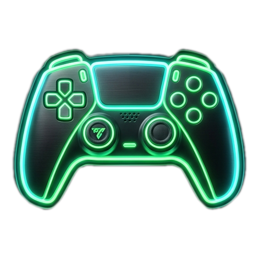

<div align="center">



# DuoPad

**Turn Any Smartphone into a Zero-Latency Wireless Xbox 360 Controller for PC Games**

*100% Free & Open Source for the Gaming Industry and Esports Community*

Play **EA Sports FC 24/25/26, FIFA, GTA V, Rocket League, Forza Horizon, Tekken 8**, and split-screen co-op with friends — No physical controller needed!

[](https://duopad-web.vercel.app)
[](duopad/LICENSE)
[](https://microsoft.com/windows)
[](#)
[-purple.svg)](#)
[](#)

</div>

---

## 🌟 Live Website & Web Controller
Visit the official DuoPad website:
👉 **[https://duopad-web.vercel.app](https://duopad-web.vercel.app)**

---

## 💡 Key Features
* **Zero Phone App Downloads** — No APK or Play Store install required. Simply point your smartphone camera at the PC screen QR code to open the gamepad instantly in Safari (iOS) or Chrome (Android).
* **Persistent Virtual Xbox 360 Gamepads** — Both Player 1 and Player 2 controllers remain persistently connected in Windows (`joy.cpl`). Games like EA Sports FC and FIFA never drop your controller assignment, even if Wi-Fi fluctuates.
* **Player 1 & Player 2 Dual Co-Op** — 2 phones connect simultaneously: Player 1 = Neon Cyan, Player 2 = Radiant Neon Magenta.
* **Sub-Millisecond Latency (<1ms)** — Direct local Wi-Fi binary WebSocket packet transmission with 120Hz display refresh support.
* **Unified Pointer Engine** — Full multi-touch support on mobile, plus mouse/trackpad pointer testing support in PC browsers.
* **Authentic Esports Xbox Layout** — 360° dual analog thumbsticks, tactile 8-way D-Pad with cyber directional arrows, LB/RB bumpers, LT/RT analog triggers, Start, Back, and Guide.
* **100% Free & Open Source** — Dedicated to the gaming industry with zero ads, zero data tracking, and zero hidden costs.

---

## 🚀 Quick Start

### 1. Installation
Clone this repository and run the setup script:
```bash
git clone https://github.com/Mastur4492/DuoPad.git
cd DuoPad/duopad
Install_DuoPad.bat
```
*(Or download the 1-click Windows setup installer `DuoPad_Setup.exe` from [duopad-web.vercel.app](https://duopad-web.vercel.app)).*

### 2. Launching
1. Launch **DuoPad** from your Desktop shortcut or run `Run_DuoPad.bat`.
2. The DuoPad Hub window appears and displays your local connection QR code.
3. Scan the QR code with your phone camera, rotate to **Landscape mode**, and play!
4. *(Optional)* Click **"🎮 Test Gamepads (joy.cpl)"** in the Hub to see both Xbox 360 controllers responding in real time.

---

## 📂 Project Structure
* `duopad/` — Windows Desktop Hub application, Python WebSocket server, ViGEmBus virtual gamepad engine, and mobile gamepad HTML/JS.
  * `server.py` — High-performance async WebSocket server.
  * `duopad_hub.py` — Native desktop hub GUI with live player input telemetry.
  * `static/controller.js` — Esports touch engine with unified pointer support.
  * `templates/index.html` — Mobile virtual Xbox 360 gamepad UI.
  * `Launcher.cs` — Universal native Windows launcher.
* `duopad-web/` — High-converting modern landing page deployed on Vercel.

---

## 📜 License
Licensed under the [MIT License](duopad/LICENSE). Free for personal, commercial, and esports use.
